# LANMAN

**LANMAN** is a hyper-local, decentralized Android messaging application built on a strict **Zero Cloud Footprint** philosophy. Devices on the same Wi-Fi network or Local Area Network (LAN) discover each other locally, verify identities out-of-band via QR codes and cryptographic safety numbers, and exchange end-to-end encrypted messages, files, images, and voice notes directly peer-to-peer—with no cloud servers, accounts, phone numbers, or internet connectivity required.

---

## Verified Architecture

LANMAN runs an offline-first, store-and-forward messaging engine hosted inside `RadarService` (a `remoteMessaging` foreground service):

```mermaid
flowchart LR
    subgraph Discovery["Discovery Layer"]
        UDP["UDP Broadcast :47474\n(LLNK Heartbeat, 3s + Burst)"]
        NSD["mDNS / NsdManager\n(_lanman._tcp.)"]
        NET["ConnectivityManager\nNetworkCallback"]
    end

    subgraph Transport["Dual-Channel TCP Transport"]
        CTRL["Control Socket :47475\n(64 KB buf · v2 Auth · TEXT/ACK/READ/OFFER)"]
        DATA["Data Socket :47476\n(1 MB buf · v2 Auth · Chunks/Hash/Complete)"]
    end

    subgraph Security["Security & Crypto Layer"]
        SIG["Signal Protocol (libsignal 0.86.5)\nPQXDH (Kyber-1024) + Double Ratchet"]
        AUTH["PeerAuth (Ed25519 Challenge-Response\n& Pairwise Safety Numbers)"]
        GCM["StreamingEncryption\nAES-256-GCM 512 KB chunks + SHA-256"]
    end

    subgraph Data["Local Persistence & UI"]
        ROOM["Room DB v9 (lanman_db)\nStore-and-Forward Queue"]
        KEY["SecureKeyStore\nAndroid Keystore AES256_GCM"]
        UI["Jetpack Compose UI\nDark / Light / System Theme"]
    end

    Discovery --> Transport
    Transport <--> Security
    Security <--> Data
```



### Layer Summary

1. **Discovery Layer** (`NetworkDiscoveryManagerImpl`, `PresenceTrackerImpl`)
   - Broadcasts compact `"LLNK"` heartbeats over **UDP port `47474`** (every 3 seconds + 3-packet 200ms burst on startup/Wi-Fi change) and registers/discovers peers via Android **`NsdManager`** (`_lanman._tcp.`).
   - Reacts immediately to Wi-Fi transitions via `ConnectivityManager.NetworkCallback`, clearing stale caches and closing dead sockets.
   - Tracks peer liveness in memory and throttles Room `lastKnownIp` / `lastSeenAt` writes (on IP change or every 30s) to avoid SQLite churn.

2. **Transport & Protocol Layer** (`ConnectionManagerImpl`, `FrameCodec`, `HeartbeatCodec`)
   - **Control Channel (TCP `47475`):** Handles handshakes, keepalive `PING`/`PONG` (20s interval, 50s idle timeout), encrypted text messages, `ACK`/`READ` receipts, key-bundle exchanges, and encrypted `FileOfferFrame`s.
   - **Data Channel (TCP `47476`):** Streams high-throughput `FileChunkFrame`s (512 KB chunks), `FileHashFrame`s (SHA-256), and `FileCompleteFrame`s on a dedicated ordered socket so large transfers never head-of-line block chat text.
   - **Protocol v2 Mutual Authentication:** `HELLO` carries a 32-byte client challenge; paired contacts perform mutual Ed25519 signature verification (`AUTH_CHALLENGE`, `AUTH_RESPONSE`, `AUTH_RESULT`) bound to sender/receiver IDs and channel tag (`CTRL`/`DATA`), rejecting spoofed UUIDs, hijacked data sockets, and blocked contacts.
   - **Safe Binary Framing:** Every `FrameCodec` length prefix and inner field is bounds-checked (`256 KB` cap for control frames, `10 MB` max frame size) prior to allocation.

3. **Security Layer** (`EncryptionEngine`, `SessionManager`, `SignalStoreImpl`, `PeerAuth`, `StreamingEncryption`, `SecureKeyStore`)
   - End-to-end encryption using `libsignal` PQXDH (`IdentityKeyPair`, `SignedPreKeyRecord`, `KyberPreKeyRecord`) + Double Ratchet protected by per-contact `Mutex` synchronization.
   - `SignalStoreImpl` enforces strict identity-key pinning against QR-paired contacts and consistent identity checking across unpaired message requests.
   - Out-of-band pairing displays cryptographic fingerprints and pairwise **Safety Numbers**, warning users explicitly if a contact's identity key changes.
   - Private Signal keys and active file-transfer keys are stored in Android Keystore-backed `EncryptedSharedPreferences`.

4. **Data & Store-and-Forward Layer** (`LanmanDatabase`, `MessageDispatcher`, `IncomingMessageReceiver`, `FileTransferReceiver`)
   - Room v9 database with explicit schema migrations (`1->4`, `4->5`, `5->6`, `6->7`, `7->8`, `8->9`).
   - Outbound messages persist locally (`PENDING`) before dispatch, enqueue automatically across offline periods, prioritize text ahead of large files, support in-flight cancellation, and clean up temporary staged files and transfer keys on `ACK`.
   - Incoming transfers buffer out-of-order dual-channel early chunks briefly, verify chunk ordering/size/SHA-256 digest, enforce a 2 GB limit and 50 MB disk margin, and reject unknown/blocked senders safely.

5. **Presentation Layer** (`ui/*`)
   - Jetpack Compose Material 3 **Translucent Monolith** design system supporting **Dark**, **Light**, and **System** theme modes.
   - Contextual onboarding, Chat List with live LAN status pill and Quick-Scan/My-QR actions, Contact Discovery & Detail screens with Safety Numbers, Message Requests (Accept / Decline+Undo / Block), Conversation UI (delivery/read ticks, timestamps, image preview, file progress speed, cancel/retry), hold/slide-to-cancel Voice Recording (`MediaRecorder` AAC + `ON_PAUSE` cleanup) & scrubbing `VoicePlayer` (shared mutual-exclusion coordinator + audio focus), and Settings (Theme, Read Receipts, Discovery Pause/Diagnostics, Network Troubleshooting, Data Wipe).

---

## Tech Stack

- **Language & Build:** Kotlin `2.0.21`, Android Gradle Plugin `9.1.1`, Gradle `9.3.1`, JVM `17`
- **Android SDK:** `minSdk 26`, `compileSdk 35`, `targetSdk 35`
- **UI:** Jetpack Compose (BOM `2024.09.00`), Material 3, Navigation Compose, Coil `2.6.0`
- **DI & Async:** Hilt `2.60.1`, Kotlin Coroutines & Flow `1.11.0`, Room `2.8.4`
- **Crypto & Scanning:** `libsignal-android` / `libsignal-client` `0.86.5`, `androidx.security:security-crypto`, CameraX `1.4.0`, ML Kit Barcode Scanning `17.3.0`, ZXing `3.5.3`

---

## Building & Running Tests

### Prerequisites

- Android Studio Ladybug or newer
- Android SDK 35
- JDK 17+ (project compiles JVM bytecode target 17)

### Debug APK & Unit Tests

```bash
# Build debug APK
./gradlew assembleDebug

# Run JVM unit tests (52 unit tests across protocol, crypto, receivers, dispatcher, use cases & ViewModels)
./gradlew testDebugUnitTest

# Run Android lint
./gradlew lintDebug

# Compile / run instrumentation tests (requires attached device or emulator)
./gradlew compileDebugAndroidTestKotlin
./gradlew connectedDebugAndroidTest
```

### Signed Release Build

LANMAN enables R8/ProGuard minification (including stripping `Log.v`/`Log.d`/`Log.i` in release).

1. Create a signing keystore:
   ```bash
   keytool -genkey -v -keystore release.jks -keyalg RSA -keysize 2048 -validity 10000 -alias lanman
   ```
2. Copy `keystore.properties.template` to `keystore.properties` in the project root and populate your credentials.
3. Build the release APK:
   ```bash
   ./gradlew assembleRelease
   ```
   Output APK: `app/build/outputs/apk/release/`.

---

## Permissions

| Permission | Purpose |
|---|---|
| `INTERNET`, `ACCESS_WIFI_STATE`, `ACCESS_NETWORK_STATE`, `CHANGE_WIFI_MULTICAST_STATE` | Required by Android to open LAN TCP/UDP sockets, read local subnet interfaces, receive UDP broadcasts, and monitor Wi-Fi connectivity. LANMAN makes **no external internet connections**. |
| `FOREGROUND_SERVICE`, `FOREGROUND_SERVICE_REMOTE_MESSAGING`, `WAKE_LOCK` | Keeps peer discovery and encrypted store-and-forward queue active in the background (with an explicit **Pause** action in the notification and Settings). |
| `CAMERA` | Requested only when opening **Scan QR Code** to scan a peer's QR pairing code locally. |
| `RECORD_AUDIO` | Requested only when holding the microphone button to record an encrypted voice message. |
| `POST_NOTIFICATIONS` | Local notifications for incoming messages and message requests (lockscreen content hidden via `VISIBILITY_PRIVATE`). |

---

## Network Requirements & Troubleshooting

- **Same Subnet Required:** Both devices must be on the same Wi-Fi/LAN subnet without **AP / Client Isolation** (many guest, campus, hotel, and corporate Wi-Fi networks block device-to-device packets and UDP port `47474` broadcasts).
- **Mobile Hotspot Mode:** If router isolation blocks discovery, turn on a mobile hotspot on one device and connect the other to it; both devices can then discover and communicate directly without mobile data or internet.
- **Firewalls / VPNs:** Disable active VPN tunnels if LAN traffic is routed through the VPN interface rather than `wlan0`.
- **Battery Optimization:** Some OEM skins aggressively throttle background sockets; keep the notification active or exempt LANMAN from aggressive background restrictions when expecting offline deliveries.

---

## Known Limitations & Scope

- **Single-Device Identity:** LANMAN is currently designed for single-device profiles (`deviceId = 1`).
- **Database Encryption at Rest:** Long-term cryptographic keys and active transfer keys are stored in Android Keystore-backed `EncryptedSharedPreferences`; the SQLite message database (`lanman_db`) relies on Android OS file-based encryption and app-sandbox isolation (Cloud Auto Backup is strictly disabled). See [`docs/SECURITY_AUDIT.md`](./docs/SECURITY_AUDIT.md).
- **Same-LAN UUID Announcements:** Discovery heartbeats broadcast the device's UUID locally over Wi-Fi; pause discovery in **Settings** when connected to untrusted public networks.
- **Additional Documentation:**
  - [`docs/ARCHITECTURE.md`](./docs/ARCHITECTURE.md) — Protocol wire format, security model, DB migrations & manual 2-device test matrix
  - [`docs/PROJECT_AUDIT.md`](./docs/PROJECT_AUDIT.md) — Audit & post-remediation tracker
  - [`docs/SECURITY_AUDIT.md`](./docs/SECURITY_AUDIT.md) — Security review & hardening report
  - [`PRIVACY_POLICY.md`](./PRIVACY_POLICY.md) — Zero-cloud privacy guarantees

## License

MIT License. See [`LICENSE`](./LICENSE) for details.
