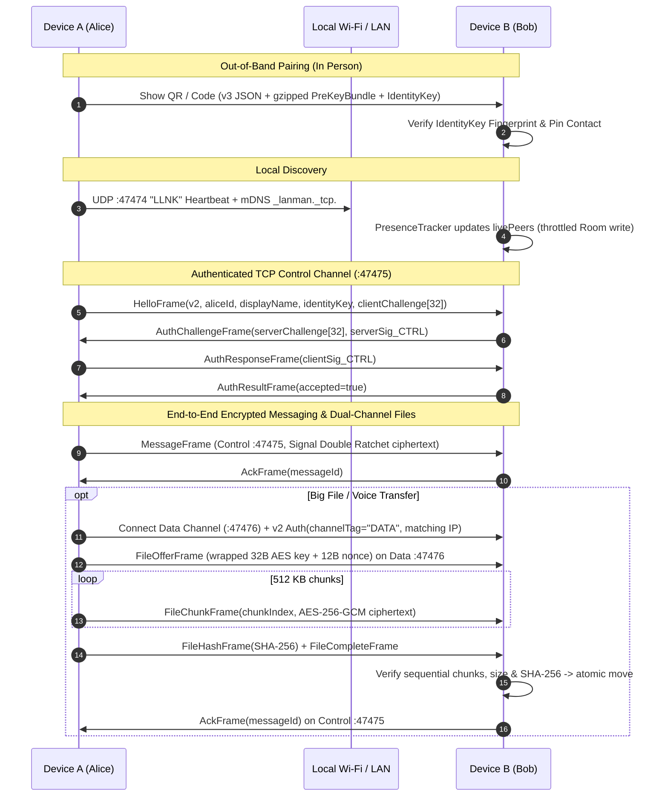

# LANMAN — Architecture & Protocol Specification

This document describes the verified runtime architecture, wire protocol, security guarantees, persistence schema, and two-device verification checklist for LANMAN.

---

## 1. Runtime Engine & Data Flow



---

## 2. Network & Wire Protocols (`com.prakhar.lanman.domain.network`)

### Ports & Buffers (`NetworkConstants.kt`)

| Channel | Protocol / Port | Buffer Size | Purpose |
|---|---|---|---|
| Discovery | UDP `:47474` + mDNS `_lanman._tcp.` | 1 KB packet | Periodic 3s heartbeat + 3-packet 200ms burst; mDNS service discovery |
| Control TCP | TCP `:47475` | `64 KB` | Handshake, `PING`/`PONG` (20s / 50s timeout), `MESSAGE`, `ACK`, `READ`, key bundles, fallback offers |
| Data TCP | TCP `:47476` | `1 MB` | Ordered streaming of `FILE_OFFER`, `FILE_CHUNK` (512 KB), `FILE_HASH`, `FILE_COMPLETE` |

### UDP Heartbeat (`HeartbeatCodec.kt`)

```text
+------------+------------+------------+------------------+------------+
| Magic (4B) | Version(1) | IdLen (1B) | UUID (UTF-8)     | TCP Port   |
|  "LLNK"    |     1      |  <= 255    | (N bytes)        | (2B UShort)|
+------------+------------+------------+------------------+------------+
```

### TCP Binary Framing (`FrameCodec.kt`)

```text
+------------------+-------------+----------------------------------+
| FrameLength (4B) | Type (1B)   | Payload (FrameLength - 1 bytes)  |
+------------------+-------------+----------------------------------+
```

- **Bounds Enforcement:**
  - `FrameLength` must satisfy `1 <= FrameLength <= 10 MB` (`MAX_FRAME_SIZE`).
  - All non-chunk control frames are capped at `256 KB` (`MAX_CONTROL_PAYLOAD_SIZE`) before allocating buffers.
  - Subfields (`string` 1B/2B length prefixes, `byteArray` 4B length prefixes) are validated against remaining buffer bytes and type limits prior to allocation; oversized UTF-8 fields fail cleanly on encode.
- **Frame Types (`FrameType.kt`):**
  - `0` `HELLO` (supports v1 fields + optional v2 `protocolVersion`, `clientChallenge`)
  - `1` `PING` / `2` `PONG`
  - `3` `MESSAGE`
  - `4` `ACK` / `5` `READ`
  - `6` `FILE_OFFER` / `7` `FILE_CHUNK` / `8` `FILE_COMPLETE` / `14` `FILE_HASH`
  - `9` `KEY_BUNDLE_REQUEST` / `10` `KEY_BUNDLE_RESPONSE`
  - `11` `AUTH_CHALLENGE` / `12` `AUTH_RESPONSE` / `13` `AUTH_RESULT`

---

## 3. Security & Cryptographic Design

### Mutual Handshake Authentication (`PeerAuth.kt`, `ConnectionManagerImpl.kt`)

- Transcript signed for every handshake:
  `"LANMAN_AUTH_V2|<channelTag>|<signerId>|<verifierId>|<challengeBytes>"`
  where `<channelTag>` is `"CTRL"` (port `47475`) or `"DATA"` (port `47476`).
- Ed25519/XEdDSA signatures use each peer's Signal `IdentityKeyPair` / pinned `IdentityKey`.
- Incoming Data Channel (`47476`) sockets must both originate from the same remote IP as the peer's active Control session **and** pass `"DATA"` challenge-response authentication (when authenticated on Control).
- Blocked contacts (`BlockedContactsStore`) are dropped immediately at TCP accept, frame ingestion, and file-offer ingestion.

### End-to-End Encryption (`EncryptionEngine.kt`, `SessionManager.kt`, `SignalStoreImpl.kt`)

- **Session Establishment:** PQXDH / X3DH using `IdentityKey` + `SignedPreKey` + `KyberPreKey` (`KYBER_1024`). One-time EC prekeys are intentionally omitted from reusable QR bundles so multi-session re-handshakes do not fail after single use.
- **Concurrency Safety:** All `SessionCipher` and `SessionBuilder` calls are serialized per contact via `ConcurrentHashMap<String, Mutex>`.
- **Identity Key Pinning:** `SignalStoreImpl.isTrustedIdentity()` checks incoming `PreKeySignalMessage` keys against paired contact records in `ContactDao` (rejecting mismatches with `UntrustedIdentityException` without auto-resetting sessions) and requires key consistency across unpaired `MessageRequest`s.
- **Out-of-Band Verification:** `PeerAuth.keyFingerprint()` (24-hex fingerprint) and `PeerAuth.pairwiseSafetyCode()` (symmetric 32-hex safety code across local and peer `IdentityKey`s) are surfaced in **My QR**, **Scan Contact** (including an explicit key-change warning alert), and **Contact Detail**.

### File & Voice Integrity (`StreamingEncryption.kt`, `FileTransferReceiver.kt`, `MessageDispatcher.kt`)

- **Per-Transfer Key:** Fresh 32-byte AES-256 key + 12-byte base nonce generated with `SecureRandom`, encrypted inside `FileOfferFrame` via Signal Double Ratchet, and held only in `SecureKeyStore` until `ACK` or cancellation.
- **Chunk Encryption:** 512 KB chunks encrypted under `AES/GCM/NoPadding` with per-chunk nonce `deriveNonce(baseNonce, chunkIndex)`.
- **Transfer Verification:** Enforces sender identity ownership (`state.contactId`), sequential `chunkIndex == expectedChunkIndex`, `bytesReceived <= fileSizeBytes`, `expectedTotalChunks`, `2 GB` max size, `50 MB` free-space margin, and whole-file SHA-256 (`FileHashFrame`).
- **Dual-Channel Race Guard:** `EarlyFrameBuffer` temporarily stages up to 4 MB / 8 chunks / 5s if data-socket frames arrive just ahead of `FileOfferFrame`, ensuring zero dropped starts across sockets.

---

## 4. Database Schema & Migrations (`LanmanDatabase.kt`, `DatabaseModule.kt`)

- **Database:** `lanman_db` (v9), automatically renames legacy `local_link_db` on upgrade.
- **Entities:** `profiles`, `contacts`, `messages` (FK `CASCADE` on `contacts`), `file_transfers` (FK `CASCADE` on `messages`), `sessions`, `message_requests`.
- **Explicit Migration Chain:**
  - `MIGRATION_1_4`: Adds `sessions` table.
  - `MIGRATION_4_5`: Rebuilds `file_transfers` with `FOREIGN KEY(messageId) REFERENCES messages(id) ON DELETE CASCADE` + `index_file_transfers_messageId`.
  - `MIGRATION_5_6`: Adds nullable `thumbnailUri` column to `file_transfers`.
  - `MIGRATION_6_7`: Adds `message_requests` table.
  - `MIGRATION_7_8`: Schema parity step.
  - `MIGRATION_8_9`: Replaces single `index_messages_contactId` with composite indexes `index_messages_contactId_timestamp` and `index_messages_status_direction_contactId`.

---

## 5. Package Map

- `data/engine/` — `MessagingEngineImpl`, `RadarService` (foreground service + `"Pause"` notification action)
- `data/local/` — Room entities, DAOs, type converters, `LanmanDatabase`
- `data/network/` — `NetworkDiscoveryManagerImpl`, `ConnectionManagerImpl`, `PresenceTrackerImpl`, `MessageDispatcher`, `IncomingMessageReceiver`, `FileTransferReceiver`
- `data/notification/` — `NotificationHelper` (`VISIBILITY_PRIVATE`), `NotificationPreferences` (`AppThemeMode`, read receipts, discovery toggle)
- `data/security/` — `SecureKeyStore`, `SignalStoreImpl`, `BlockedContactsStore`, `MutedChatsStore`
- `domain/` — Clean domain models, repository interfaces, `Frame`/`FrameCodec`/`HeartbeatCodec`, `PeerAuth`/`EncryptionEngine`/`SessionManager`/`StreamingEncryption`, use cases
- `ui/` — Theme (`Color`, `Type`, `Theme`, `Animation`), common components (`Glass*`, `LanmanTopBar`, `VoicePlayer`, `VoiceRecordButton`, `MessageCard`), screens & ViewModels

---

## 6. Two-Device Manual E2E Verification Checklist

Single-device database/migration tests can run directly via `connectedDebugAndroidTest`, while full P2P radio/network flows require **two physical Android devices (A & B)** on the same non-isolated Wi-Fi subnet (or mobile hotspot):

1. **Onboarding:** Complete onboarding on A and B; confirm profile IDs differ and no runtime permissions are prompted before feature entry.
2. **Discovery & UI Pill:** Open Chat List on both; verify both transition to active LAN status and show peer presence under Contacts / Nearby.
3. **QR Pairing & Safety Number:** Scan A's QR from B; verify fingerprint & Safety Number match across `MyQrCodeScreen`, `ScanContactScreen`, and `ContactDetailScreen`. Re-scanning a modified key bundle with the same UUID displays the red key-change warning.
4. **Online 1:1 Text Chat:** Send rapid messages A <-> B; check ascending timestamps, `SENT -> DELIVERED -> READ` ticks, and no lockscreen body leak when screen is locked.
5. **Offline Queue & Auto-Flush:** Toggle Wi-Fi off on B, send 3 text messages + 1 file from A (`PENDING`), turn Wi-Fi back on for B, and confirm automatic flush + `DELIVERED` transitions without duplicates.
6. **Priority Over Large File:** Start sending a large (>50 MB) video from A while offline-queued or streaming; immediately send a text message and verify text arrives ahead of remaining file chunks.
7. **In-Flight Cancel:** Cancel a large file transfer mid-stream on A; verify Data stream stops immediately and transfer settles as failed cleanly without completing on B.
8. **Voice Messaging:** Hold microphone button to record; test slide-left cancel (no message sent), normal release (plays smoothly with seek scrubber & live elapsed counter, mutual exclusion when playing multiple notes), and switching away mid-recording (`ON_PAUSE` safely stops mic).
9. **Unknown Sender & Block:** Clear/unpair on B only and message B from A; verify B receives `MessageRequest` (multiple lines combine in preview), Decline + Undo restores it, Block drops subsequent frames and rejects sockets/files cleanly.
10. **Wi-Fi / Subnet Switch:** Switch A to a mobile hotspot (with B joining the same hotspot); verify `NetworkCallback` closes stale sockets and reconnects within seconds without restarting the app.
11. **Contact Deletion & Storage Hygiene:** Delete contact on A; verify messages, `received_files`, `thumbnails`, and `transfer_keys` for that contact are gone while keeping files exported outside app storage.
12. **Wipe All Data:** Run **Settings -> Clear local data** (typing `DELETE`) and confirm clean return to Onboarding with empty tables and wiped Keystore.
